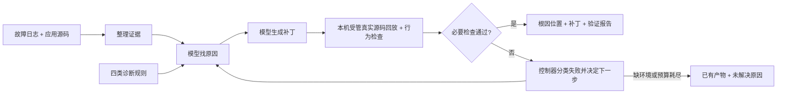

# 项目蓝图与开发导览

状态：当前开发入口。最后维护：2026-10-17。
职责：先用通俗语言说明要做什么、如何做和重点在哪，再提供文件导航。这里是设计的概览；具体技术决策以开发设计为准，实际进度以 STATUS 为准。

## 1. 我们最终要做出什么

**做一个普通电脑可运行的故障定位与自修复 Agent：给它 HarmonyOS 等应用的源码和故障日志，配置云端模型，它自动找原因、修改代码；有宿主验证器时回放相关真实源码，失败后根据反馈继续修，最后交出补丁和验证报告。** Windows x64 是当前部署范围，不要求 HarmonyOS 真机、模拟器、签名或完整应用构建环境，也不承诺其他操作系统已经验收。

当前产品形态是命令行 Agent，competition 处理单个故障。面向用户的入口设计采用 Strix 式直接传参：`dfx --target 任务快照 --config 配置` 启动，`--resume NAME` 恢复，`status/logs/stop/report NAME`追踪运行，`cases`列出本机已准备命令，`prepare`准备审核输入，`export`导出可浏览结果；新任务加`--export-result`可自动导出；实际安装及验收状态见 STATUS。任务快照同时含源码与故障日志，不再强制绑定完整应用。analysis 模式可以直接分析和产出未验证补丁；source_execution 模式使用预先接纳的宿主运行器检查原版和冻结候选，得到限于相应逻辑与输入的验证结论。synthetic 用于软件自检，完整 application 验证保留为可选扩展。人准备允许输入与可信业务要求，系统负责读取、修改、调用已批准检查和有界修订；没有检查能力时如实报告未验证。

用户最终拿到三类结果：

- **定位结果**：哪个文件、哪几行造成问题，以及日志和代码依据。
- **修复产物**：实际可应用的代码补丁，说明改变了什么。
- **验证记录**：原故障是否复现、补丁后是否消失、功能/回归是否通过、尝试了几轮、用了多少资源。无法完成时明确指出卡在哪里。

默认 `dfx configure --save RUN` 生成 analysis 配置；`--validation PROFILE` 选择宿主源码检查，`--application PROFILE` 选择完整应用扩展，二者互斥。analysis 输出 `analysis_completed` 或 `patch_proposed`，不表示验证成功；`source_verified` 仅表示声明的宿主源码协议通过，`application_verified` 才表示完整应用协议通过。报告 schema 4 的 accepted 按这个验证层级解释，不能脱离 verification_level 和覆盖说明引用；历史报告保持原含义。

每次测试的原运行保存在`.dfx-local/work/competition-<run_id>/`，面向人的结果目录为`runs/exports/cases/<task_id>/<run_id>/`。新ID表示一次新测试，恢复原ID表示继续原预算和账本。目录含解释、根因、patch、冻结源码、检查、时间/Token/缓存费用及原证据；首次导出可核对并附带原工程资源。完整操作与换机前置统一见[使用说明](src/dfx_agent/README.md)，本导览不另维护命令矩阵或成绩表。
这些是目标产品能力，现有实现与验证范围见 [STATUS](docs/STATUS.md)。轻量主线复用已有 SDK 循环、云端请求、上下文、Skills 和本机执行。用户于 2026-10-17 确认 Key 已配置，并授权在有限总预算内进行真实 DeepSeek 测试；先零推理预检，再小额接入与代表源码回放，确认后才扩大范围。软件验收、已配置与已授权都不能推定真实模型兼容性或修复效果通过，实际结果只记 STATUS。

## 2. 用一个例子理解它怎样工作

例如：某页面加载数据时崩溃，日志指向一次`Uint16Array`构造。下面解释业务路径；该案例的具体实测及覆盖范围见STATUS，不将局部源码通过解释为整个页面/应用通过。

1. **读故障**：找到报错位置，读取附近代码及相关调用，识别“缓冲区容量不够”。
2. **找原因**：发现前面按 N 个字节分配容量，后面却想放 N 个 16 位元素，需要 2N 个字节；报错发生在使用处，问题来自容量与使用方式不一致。
3. **检查业务含义**：继续读生成和校验逻辑，确认这段数据应该如何编码、谁还会使用它。
4. **提出补丁**：选择与这些用途一致的容量或构造方式，输出实际 diff；不能只靠缩短数据让异常消失。
5. **验证并调整**：由宿主运行器加载原版与候选中的相关真实逻辑，回放输入并检查正常、边界和业务结果。如果不崩溃了但校验结果错误，反馈给下一轮修复；平台接口用 mock 时说明它覆盖及未覆盖什么。

我们想让系统学会的工作方式就是：**从“哪里报错”追到“哪个必要条件被破坏”，再修复原因并验证原有功能。**

## 3. 整个系统由什么组成



**大模型负责理解与修改，程序负责执行与判断流程是否完成。** 模型可以提出“应该修好了”，但只有实际验证记录满足选定层级的协议，控制器才给出该范围内的通过结果。Agent、源码回放与评测都在本机受管运行，基础模型调用云端 API，不部署本机模型权重。完整应用构建/设备回放是可选后端，不是使用 Agent 的前置。

共同验收协议在看候选结果之前按故障变体和源码版本固定。宿主源码级验证要求实际加载原版/候选相关源码，原版在回放输入下触发指定故障，候选通过同一目标、业务和回归检查；抽取/转译步骤、平台 mock 及语义限制必须披露。不能用另一份手写的“正确算法”替代被修代码，也不能只重读历史日志。完整 application 后端仍要求完整工程和平台执行事实。缺检查、仅静态分析或 synthetic 通过不得写成源码/应用修复成功，宿主通过也不自动成为完整应用成功。具体字段和拒绝条件见 [模块规格](docs/design-contracts.md#13-补丁验证和尝试)，接受与评测口径见 [评测规格](docs/preparation/metrics-and-gates.md)。

## 4. 工作重点与自己的贡献在哪里

| 工作点 | 我们具体要设计/实现什么 | 在项目中的作用 |
|---|---|---|
| 完整修复闭环 | 读代码、调用模型、应用补丁、运行测试、记录失败并重试 | 参赛底座，首先保证端到端能工作 |
| 修复义务引导的根因分析 | 关联根因假设、必须恢复的条件和必须保留的业务行为，让同一记录贯穿定位、补丁与验证 | 拟议核心贡献：提高定位与修复选择质量 |
| 按决策需要查证与修订 | 简单故障直接修；不同解释会导向不同修法时补查源码/日志，失败反例更新对应义务 | 拟议核心贡献：减少错误方向和无效重试；当前没有运行诊断探针 |
| 上下文、经验与静态 Skill | 围绕当前假设与义务选择上下文；旧经验先核对适用条件，未知时提供查证步骤；提供完整的领域过程指导 | 竞赛版方法载体：减少证据遗漏与错误迁移，逐项比较后决定是否启用 |
| 跨任务 Skill 演进 | 从允许的反馈提炼候选，经独立验证后晋升或退回 | 后续扩展：研究经验更新与迁移收益，不作为当前竞赛版交付前置 |
| 业务验证与评测 | 检查修复是否保留原功能，公平比较基础系统和增强系统 | 证明效果，避免只消除崩溃却破坏功能 |

例如，两种修法都能避免越界，但只有一种保持原校验结果。Agent 应先查清这个差别，再决定修改；若已有代码证据足够，就不额外消耗一次运行。明确需要检查什么、何时检查，以及检查失败改变哪项决策，是我们要落实的方法细节。

**我们的重点是成熟 runtime 上的领域 harness。** Skills 属于方法设计和交付的一部分：把经验变成有适用前提、查证分支、保留行为及退出条件的过程，例如“容量与元素数怎么检查”。贡献通过可迁移程序、选择/更新机制和效果证明，文件数量不作为成绩。基础模型继续规划通过云端 API 接入通用大模型，不规划参数微调。

根目录 `skill/` 是唯一的 Skill 维护和竞赛提交入口。`bounds/`、`lifecycle/`、`recursion/`、`dynamic-pattern/` 各有标准 `SKILL.md`，使用 YAML 的 name/description 和可读 Markdown 保存前提、查证步骤、保留行为及反例。新增自设计或外部 Skill 直接放入独立子目录，配套资料、脚本和模板放在该包内，不再维护 JSON 定义。competition 动态发现并冻结这些原文，复用 SDK 目录解析及现有 read_skill：启动只给名称与触发描述，正文和引用资料按需读取。脚本读取不会自动执行，外部工具要求须另行接纳；实际验收与效果边界见 STATUS。

任务内 context、memory 和 Skills 服务于同一修复决定。完整历史留在本机，任务记忆保存假设、证据、义务和候选检查；模型每步看到按修复阶段构建的决策工作集。定位时重点是竞争根因、矛盾与待查证问题，改代码时是恢复条件和保留行为，失败后是原候选反例和修订问题。竞赛配置用 decision_frontier 复用当前已保存决策，展示具体问题与反证入口；repair_frontier 筛选原文，跨诊断保留最近实际失败，并给移出探索留下有界的版本回读导航。必要工具正文只发送一份，完整语义和原历史保持。任务语义记忆是增量条目，通用语义摘要在竞赛入口尚未启用；这些安排不证明模型效果。方法与能力边界见 [设计第7.1节](docs/development/system-design-draft.md#71-以当前修复决定组织工作上下文)。

旧经验先核对适用前提，未知就给出查证问题。判断仍由模型提出，程序核对引用和执行事实，不认证因果语义。修复义务与决策建议是可选指导；实际是否改变后续读取、补丁及失败修订，必须观察和比较。合成闭环不能证明自主纠错效果或 Token 节省，图存储本身也不形成方法收益。

**当前不继续开发跨任务自动提炼/晋升、完整版本治理、全生命周期科研账本及自动采值。** 它们是延期研究扩展，已有代码、失败和独有契约保留在 [设计第 7 节](docs/development/system-design-draft.md#7-skills-的具体位置) 与 [规格第 3.1 节](docs/design-contracts.md#31-工作上下文经验与-skill-的实施契约)，不进入竞赛交付前置。来源核验、追踪界面和 schema 数量属于工程能力，不作为修复效果贡献。

论文希望回答的具体问题是：**相同模型、知识、工具和预算下，围绕当前修复义务组织证据并迁移经验，是否能减少错误尝试，交出更多保留功能的补丁？** 以静态 Skill、普通案例检索和可关闭的机制比较解释收益；目前没有效果证据。

我们的竞争力目标是：**同模型、同工具和总预算下，比强通用代码 Agent 少做错误尝试，交出更多保留功能的正确补丁。** 先做强基础版，再逐项加入增强；简单问题直接修，存在影响修法的歧义才查证。增强造成的失败和额外成本也要计入，不能只展示被救回的案例。

审阅具体方案时，先看 [开发设计第 8 节](docs/development/system-design-draft.md#8-竞争力设计与成立条件) 的业务路径、机制和成立条件，按需再看第 7 节的上下文/Skill 实现。比较公平性与接受条件见 [评测口径](docs/preparation/metrics-and-gates.md)。这些是可检验的设计假设，尚非效果结论。

## 5. 开发框架和资源

**Python 3.13 + Deep Agents SDK（底层 LangGraph）+ Pydantic 2 + langchain-core + SQLite** 是首版 Agent 技术底座。云端通信复用锁定的官方 OpenAI Python SDK；同类 Chat Completions 服务默认在 Git 忽略的 `configs/model.local.json` 统一填写地址、模型、Key、单任务预算及网络重试/超时，环境变量保留为兼容选项，不自研供应商通信库。当前接纳对象为 deepseek-flash、thinking enabled，工具续轮保留提供方要求的完整推理历史，不擅自关闭用户模式。连接未建立的故障及明确 429 由 SDK 有限退避，结果不明的请求不重发；重试等待受本次请求与任务剩余时间共同限制，不重跑 Agent 工具。私有批次清单 `configs/evaluation.local.json` 不含 Key，批次预算读取已有真实账本并在新 run 前预留其最坏费用；未知 usage 默认停止，只有用户显式接纳的已结束旧 run 可以全额占用原 cap 后继续新 run。金额、公式和例外条件唯一见 [评测口径](docs/preparation/metrics-and-gates.md#本次真实测试的总费用边界)。初始化、预检和参数说明见 [使用说明](src/dfx_agent/README.md)。真实服务及型号须小额核验，宿主验证器须接纳实际运行时、源码加载方式、输入和独立预期；不预设所有 `.ets` 都能在普通 JavaScript 运行时等价执行。具体选择与实现边界见 [开发设计](docs/development/system-design-draft.md)。

| 部分 | 用什么 | 为什么 |
|---|---|---|
| Agent 流程 | Deep Agents SDK / LangGraph | 实际复用工具循环、消息状态、middleware 和 SQLite 检查点；文件工具与上下文当前由项目适配，不能声称已全部复用 SDK 默认能力 |
| 输入输出 | Pydantic 2 | 检查模型动作、证据、候选与验证结果的结构 |
| 模型 | langchain-core 模型入口 + 官方 OpenAI SDK + 既有预算账本 | SDK 负责请求与响应通信；项目负责领域消息、上下文和预算。OpenAI/DeepSeek 有配置预设，其余同协议服务指定 base URL；不要求本机模型权重，不把所有型号视为已验证 |
| 状态与轨迹 | SQLite 检查点、有限活动侧录、文件产物；按需接原生 stream/callback | 不新增通用会话数据库、事件总线或自研追踪平台；外部 tracing 是可选观测 |
| 环境管理 | uv + pyproject.toml + uv.lock | 项目内隔离依赖并锁定版本；固定响应 SDK 切片已做合成验证 |
| 代码工具 | 受控读取/检索、SDK FilesystemBackend.edit、Git CLI | 原版、草稿和冻结候选明确区分；替换执行复用 SDK，领域适配负责临时草稿切换和候选登记；验收见 STATUS |
| 宿主源码验证 | Python 原生受管子进程 + 固定运行器/检查命令；相关语言运行时按案例接纳 | 实际装载原版与候选相关源码，回放故障输入并检查业务/边界；复用既有执行、预算和反馈，不另建调度底座 |
| 可选完整应用验证 | 既有 ApplicationProfile / LocalApplicationExecutor；匹配的 DevEco/SDK、Hvigor、ohpm、hdc，按需 Hypium | 仅有这些条件且需要扩展覆盖时接入，不是默认安装、配置或竞赛主线前置 |
| 开发检查 | pytest、Ruff、Pyright | 合成测试、接口检查、格式和类型检查 |

Deep Agents 提供通用 Agent 能力，LangGraph 承担底层运行。当前关闭了 SDK 默认文件动作、摘要、卸载和委派，使用已有受控工具、工作上下文及可选主机压缩；这增加了自研维护面，不能再扩展成完整通用 harness。保留现有已验边界，新增通用能力先检查锁定框架能否直接复用，不进行整栈迁移。

CLI 只承担传参、显示活动、停止/恢复与读取结果。后续需要更细观测时，优先使用 LangGraph 原生流与标准日志；可选 LangSmith 或 Langfuse 的现成适配，不开发自己的追踪服务，也不把平台部署作为运行前置。外部追踪未启用，私有输入是否允许上传须另核定。工具优先复用现成 SDK/CLI；MCP 只在已有服务能降低适配成本时采用。具体取舍和当前复用边界见开发设计第 1.1 节。

这一底座包含依赖锁、领域对象、固定响应及模拟模型协议的离线修复循环、模拟 HTTP 作业协议、可关闭的领域策略分支和调用账本。新增 competition 统一云端适配器、受管本机检查、正式领域资源及竞赛输出，实际测试证据与未通过项只见 STATUS。`agent-report.json` 保存 SDK 轨迹与摘要；竞赛交付另用 `competition-report.json`、可读的 `result.md` 和私有原件包 `delivery.zip`，保留初次/最新定位、全部候选补丁、失败、检查及未知成本。SDK 工具调用先由主机授权，恢复时回放已完成结果，已发送但未保存结果的调用保持未知并拒绝重发。

### 本机资源怎样集中管理

本机实现采用仓库内 .dfx-local 作为项目环境、缓存、临时副本和运行记录的集中位置；离线证据可通过受管 Export 保留到 runs/exports。日常只启动一个受管任务。宿主验证运行时及临时产物也纳入同一管理范围；新增运行时先检查容量、来源和停止/清理，不改全局环境。可选完整应用扩展再单独接纳 SDK/设备缓存，当前没有本机模型权重占用。停止运行、清缓存、删除环境是不同操作，均只针对本项目归属的资源。

面向用户的 `dfx` 前端负责启动、配置、进度和会话操作，`env` 管理安装、占用和按计划清理。交付范围是 Windows x64 下的完整项目目录、项目专属环境和标准 console entry。一次 `setup.cmd` 使用普通 Python 3.11+ 引导并创建锁定环境；日常用 `dfx.cmd` 或环境内的 `dfx`，生产运行不依赖 PowerShell、Codex 安装或全局 PATH 修改。Python 管理入口直接调用 Windows Job，保留停止、归属核对和资源限额；历史研究/导出 PS 入口只作开发兼容，不是产品运行前置。项目资源集中在 .dfx-local；删除 env/all 时先退出 Agent，再用外部普通 Python 的 `setup.cmd --clean` 应用预览计划，避免删除正在使用的解释器。独立 wheel 和跨平台不在本轮范围。本次授权仅开放受管模型/源码测试，application 和平台 SDK 仍禁用，资源数值不变；实际配置、验收与命令见 [Agent 说明](src/dfx_agent/README.md) 和 STATUS，限制边界见 [设计第 9 节](docs/development/system-design-draft.md#9-本机环境资源限制与集中清理)。

### 竞赛版的交付标准从哪里来

2026-10-11 查阅用户提供的 [Agent 项目索引](https://github.com/Yeti-791/Awesome-Offensive-AI-Agentic-Landscape)，再核对项目本体：[Strix](https://github.com/usestrix/strix/blob/main/docs/quickstart.mdx) 的直接任务 CLI、[BreachWeave](https://github.com/m-sec-org/BreachWeave) 的 SDK 复用和事实/方向记忆分工、[tinyctfer](https://github.com/chainreactors/tinyctfer) 的显式模型及执行环境。它们的任务与本项目不同，仓库自述成绩不作为我们的效果证据。由这些产品形态得出的本项目验收标准是：明确前置环境，一次安装，轻量模型/应用配置，一个命令启动任务，自动执行与反馈修订，能看进度/停止/恢复，最后交出补丁和可信检查记录。无需先搭建 Web、调度平台或图数据库；方法收益仍须同预算真实比较。

每次新运行保存执行源码指纹、依赖锁和实际 Python/依赖版本。恢复先核对兼容性，报告和聚合只读取当时保存的事实；旧记录的缺失版本保持未知。competition 保留选定模式的原输入/运行器、原配置、run 原件及 `.dfx-local/state/competition-<ID>-approval.json` 的原主机批准；完整 application 模式另保留原完整工程。不以新资源或新批准替换旧记录，已完成记录回放，未知发送不重做。Git 的初始观察与续跑身份分开，日常改文档不会改变执行源码的兼容身份。完整约束见 [模块规格](docs/design-contracts.md)。

Export 从显式离线评测清单保留任务源码、全部候选、账本和失败记录：先预览内容与计划，再按 PlanId 应用，最后只读 Verify 从包内重建同一摘要。competition 的 `delivery.zip` 是另一份私有交付原件包，包含字节清单；其清单核验不等于上述评测重聚合或修复有效性认证。两类包都包含原始消息和私密源码，不能直接公开；导出不删除源，也不自动放行清理。终态 work、任务快照及未发布暂存仍须在具体清理请求中明确丢弃。真实效果、宿主运行器来源与语义范围、可选应用扩展及公开脱敏须分别接纳，使用命令见 [原型说明](src/dfx_agent/README.md)。

## 6. 怎样一步步把它做出来

竞赛版的交付路线是：在累计费用门下做零推理预检与小额真实接入，022 校验逻辑和 016 公用方法由两个固定宿主协议逐例接纳，021 等其余数据按实际适配继续覆盖；每例有可信宿主检查才计源码级结果，没有 adapter 的案例仍保留 analysis/未验证。先保证真实基础闭环与完整逐例记录，预算允许再成对筛选增强，最后冻结确认并整理竞赛材料。用户明确接纳的未知费用例外仅在 charge_unknown_run_caps 中点名已结束 run，以原冻结 Token 上限全额占预算，原 unknown 和请求保持不变；默认仍是未知即停止，规则见 [评测口径](docs/preparation/metrics-and-gates.md#本次真实测试的总费用边界)。到正式截止及提前内部完成的日期、依赖和退出扩展规则统一见 [实施计划](docs/project-work-plan.md)，不在本导览复制日程或额度表；实际进度只见 [STATUS](docs/STATUS.md)。

竞赛版保留修复义务、工作上下文、有条件经验使用和任务内反馈修订。跨任务模型提炼与自动晋升、完整生命周期科研成本和自动运行采值作为扩展保留，不再阻塞该节点。交付软件后先接通并验证真实基础闭环，再按相同模型、材料、工具和预算比较增强；依据实测决定比赛配置与论文主张。

本项目不等待设备到位。优先把可在宿主运行时中保持语义的相关逻辑接成回放，用真实候选源码与独立预期验证；平台依赖无法覆盖时明确报告限制或只产出未验证补丁。完整 HarmonyOS 行为属于可选更高层验证，不把宿主结果冒充设备实测，也不预先承诺组委会会把二者视为等价成绩。

后续实施围绕完整任务路径逐步打通。换模型接手时，先读 STATUS 指定的下一包，再按 [实施计划的工作包](docs/project-work-plan.md#可直接接手的实现工作包) 查看修改范围、前置依赖和失败用例；每包通过检查再提交。资源保护和停止/清理优先于依赖安装，基础 Agent 优先于效果增强。

## 7. 文档怎么用

**理解项目先读到这里即可。** 想看做到哪一步，打开 [STATUS](docs/STATUS.md)；想看具体算法，打开 [开发设计](docs/development/system-design-draft.md)；准备实现模块时再查 [模块规格](docs/design-contracts.md)。下方是目录索引，不需要按文件顺序通读。

## 文档登记表

表中的“当前”表示唯一在用的文档，不代表其设计已经实现。证据文档的采集日期反映观察时间；提交模板的填写日期不承担开发版本管理。所有受维护 Markdown 均在此登记。

<!-- document-registry:start -->
| 路径 | 类型 | 唯一职责 |
|---|---|---|
| `DEVELOPMENT.md` | 当前入口 | 项目蓝图、阅读顺序、结构与文档登记 |
| `AGENTS.md` | 当前规则 | 助手工作流程与维护约定 |
| `docs/STATUS.md` | 当前状态 | 进度、未决条件、下一步、实测状态 |
| `docs/project-work-plan.md` | 当前计划 | 阶段顺序、依赖、完成门槛、设计缺口 |
| `docs/development/system-design-draft.md` | 当前设计 | 架构、算法与后端抽象 |
| `docs/design-contracts.md` | 当前规格 | 字段不变量、状态转换、规则卡 |
| `docs/preparation/metrics-and-gates.md` | 当前评测 | 指标、对照与验收口径 |
| `docs/preparation/data-b-assessment.md` | 当前证据 | 数据事实、异常及来源；正文分别标明采集日期 |
| `docs/preparation/prior-art.md` | 当前证据 | 文献查阅事实、可借鉴内容及限制 |
| `src/dfx_agent/README.md` | 当前说明 | 受管竞赛与离线命令、输入格式和边界 |
| `scripts/preparation/README.md` | 当前说明 | 数据盘点、代表案例有限预期及观察接收端用法与边界 |
| `README.md` | 提交模板 | 竞赛总入口 |
| `docs/technical-design.md` | 提交模板 | 正式技术设计 |
| `docs/test-report.md` | 提交模板 | 正式测试报告 |
<!-- document-registry:end -->

## 目录与文件

| 位置 | 用途 |
|---|---|
| `docs/` | 上表中的阶段、设计、规格、评测与证据文档 |
| `src/dfx_agent/` | Python 证据与修复 Agent、候选工作区、SDK 闭环、云端请求和本机检查通道、竞赛交付及受控策略；实际验收见 STATUS，模块职责见下表 |
| `scripts/dfx.py` | 加载 src 包，提供 doctor / prepare / analyze 和受管 competition / repair / resume / aggregate / export / verify-export 入口 |
| `scripts/bootstrap.py`、`setup.cmd`、`dfx.cmd` | 无 PowerShell 的一次安装/外部环境清理、仓库快捷启动；初始安装需要普通 Python 3.11+，不借用 Codex 路径 |
| `scripts/local.ps1` | 历史研究/导出及 PS 开发兼容入口；生产 competition、安装和基础检查由 Python 管理入口承担，不承担本次真实接入主线 |
| `scripts/local_job.cs`、`scripts/local_synthetic.ps1` | Windows Job/输出管道封装与固定合成工作负载；不执行模型或应用任务 |
| `scripts/local_bootstrap.ps1`、`scripts/local_test.ps1`、`scripts/local_quality.ps1` | Job 内的固定依赖安装、pytest 和文档/Ruff/Pyright 检查，不接受任意 shell 命令 |
| `scripts/local_agent.ps1` | Job 内固定响应或模拟模型协议的离线 repair / resume 工作进程，输入由管理入口限定 |
| `scripts/local_competition.ps1` | Job 内 competition 工作进程，核项目环境身份并消费管理入口固定的任务、配置、工作目录和恢复标记 |
| `scripts/local_metrics.ps1` | Job 内只读核验显式任务清单，生成新的离线汇总与终态；不调用模型或检查 |
| `scripts/local_export.ps1` | Job 内固定私有 Export 预览、Apply 和只读 Verify 工作进程，核对管理租约与项目环境 |
| `scripts/test_local_runtime.ps1`、`scripts/test_local_process.ps1`、`scripts/test_local_bootstrap.ps1` | W01 路径清理、W02 进程保护和 W03 重复 Init 的合成验收 |
| `scripts/check_docs.py` | 文档登记、链接、维护元数据及 archive 跟踪检查 |
| `scripts/preparation/inspect_dfx_data.py` | 只读盘点本地 data_B；不执行数据包脚本 |
| `scripts/preparation/check_case_observations.py` | evaluator 的有限观察接收端；比较独立预期，不执行或认证应用 |
| `tests/test_offline_evidence.py`、`tests/test_case_identity.py`、`tests/test_sdk_compat.py` | 原型合成输入、显式案例身份与固定响应 SDK 接入自检；最近结果由 STATUS 记录 |
| `tests/test_contracts.py`、`tests/test_workspace.py` | 领域对象的拒绝条件与候选隔离、登记、回退的合成反例 |
| `tests/test_conditions.py`、`tests/test_condition_store.py`、`tests/test_condition_handoff.py` | 有限条件计算、不可改写结果及固定响应 Agent 交接，含单位/范围/来源、版本、恢复和开关反例；不是应用评测 |
| `tests/test_value_sources.py` | 独立主机合成操作绑定与采值凭据反例：原字节锚点、角色/事件、不可改写登记和回读；不证明真实语法解析或运行采样 |
| `tests/test_knowledge_contracts.py`、`tests/test_knowledge_store.py` | 独立经验/快照的完整内容、主机权限交集、原字节保存、总容量与闭合回读反例；不证明经验适用性、自动学习或修复收益 |
| `tests/test_retrieval_contracts.py`、`tests/test_knowledge_retrieval.py` | 冻结指导的确定性标签/文本排序、未知标签保留、分页、记录重算、SQLite 原件/索引错配及容量反例；不是语义适用性或真实效果评测 |
| `tests/test_applicability_contracts.py`、`tests/test_applicability.py` | 当前任务/批准知识绑定、逐前提三态建议、原版/候选引用范围、冻结回读和容量反例；不证明模型判断或经验迁移收益 |
| `tests/test_knowledge_run.py`、`tests/test_knowledge_sdk.py`、`tests/test_knowledge_reporting.py` | 批准知识复制、实际 SDK/模拟请求、预算与只读恢复、查询/回执全文审计、同知识矩阵及迁移导出；不证明语义适用或修复收益 |
| `tests/test_solver_visibility.py`、`tests/test_applicability_handoff.py`、`tests/test_applicability_sdk.py`、`tests/test_applicability_provider.py`、`tests/test_applicability_reporting.py` | 实际发送依据、三态完整指导、未知回退、兄弟结果未见、共同预算、恢复与原件审计、同工具对照及迁移导出 |
| `tests/test_static_skills.py`、`tests/test_static_skill_handoff.py`、`tests/test_static_skill_sdk.py`、`tests/test_static_skill_resume_cache.py`、`tests/test_static_skill_reporting.py` | 静态编译、原生目录、完整读取、共同预算、固定/模拟 SDK 失败后修订、恢复前漂移拒绝、实际可见性、启停对照及私有导出；合成调用不证明修复收益或学习效果 |
| `tests/test_domain_skills.py`、`tests/test_standard_skill_packages.py`、`tests/test_skill_resources.py` | 根目录标准 Skill 动态接入、原文/引用资产冻结、按需及显式强加载、旧格式兼容和实际 SDK/Mock 读取恢复；不认证模型选择或修复收益 |
| `tests/test_working_context.py` | 显式焦点、来源复核、义务/证据闭包、历史反例范围、冻结回读和必要包超限的合成反例；不证明实际模型已使用或效果 |
| `tests/test_working_context_scale.py` | 同一千文件合成任务的 off/on 分析器测量及原默认预算复验；重复/不同内容分开，部分 I/O 代理与总调用耗时分开，不是模型或应用效果评测 |
| `src/dfx_agent/working_context_plan.py`、`tests/test_working_context_plan.py`、`tests/test_working_context_handoff.py` | SDK 可见工具结果到当前焦点、必要上下文和实际发送；冻结来源、完整组、后续检查进展与崩溃/未知恢复的合成验收 |
| `src/dfx_agent/working_context_materials.py`、`tests/test_working_context_materials.py` | 同 run 原字节内容寻址、不可改写引用、链接/读中变化/崩溃残留及容量验收；不跨 run 接管材料 |
| `src/dfx_agent/working_context_projection.py`、`tests/test_working_context_projection.py` | 从完整审计 packet 生成有界模型视图；仅替换来源清单，保留全部领域内容及未知/权限范围 |
| `tests/test_working_context_reporting.py`、`tests/test_working_context_metrics.py` | 新代发送计划回读、旧代不回填、显式上下文因素、公平门及私有导出合成验收 |
| `tests/test_agent_loop.py`、`tests/test_remote_contract.py`、`tests/test_policies.py`、`tests/test_action_acceptance.py`、`tests/test_model_calls.py`、`tests/test_tool_authorization.py`、`tests/test_causal_diagnosis.py`、`tests/test_decisions.py` | 固定响应闭环、模拟 HTTP、领域策略、动作/应用接受、模型与工具恢复、因果诊断及修复决策交接的合成验收 |
| `tests/test_competition_diagnosis.py`、`tests/test_reused_tool_ids.py`、`tests/test_competition_terminal.py` | 竞赛候选完整定位关联、跨轮工具 ID 复用、预算边界完成验证及 SDK/模拟修复恢复；应用接受使用回执 fixture，不证明真实应用效果 |
| `tests/test_feedback.py`、`tests/test_feedback_integration.py` | 开发反馈来源、权限、移植回读、候选与成本的合成反例；不证明自动学习质量或真实修复 |
| `tests/test_skill_validation.py`、`tests/test_skill_validation_integration.py` | 不可改写版本、外部来源批准、前置计划、同池目标过程完整读取/后续可见性、来源移走后回读及递归读取预算的合成反例；不证明学习收益 |
| `tests/test_skill_evolution.py`、`tests/test_skill_evolution_retry.py`、`tests/test_skill_evolution_audit.py`、`tests/test_skill_publication.py` | 分别检查基础合成判定、历史重试、配置/来源关闭审计、沙盒发布/退回/冻结旧选择；共用非测试模块 `tests/skill_evolution_support.py` 的真实 SDK 合成原件。新激活必须使用候选当前判定，旧发表仍可回读；不证明自主学习或 SDK 已消费别名 |
| `tests/test_skill_evolution_receipts.py` | 单操作内回执复用、下一次重新认证、批准/预算漂移、原字节恢复与目录成员反例；隔离昂贵语义重建，生产读取与公共关闭路径照常执行，完整 SDK 整链另有验收 |
| `tests/test_learning_model_calls.py` | 独立学习意图代、全部用途预算、未发送/未知/完成回放、格式修复父链及请求/响应/usage 漂移；来源语义准入仍须上层工作流 |
| `tests/test_learning_workflow.py`、`tests/test_learning_workflow_audit.py`、`tests/test_learning_root_binding.py` | 分别检查完整反馈正文到模拟请求/待审核草案、来源/账本/容量反例和物理工作根绑定；共用非测试模块 `tests/learning_workflow_support.py` 的已停止 SDK 合成反馈。仅 MockTransport，不证明学习质量或迁移收益 |
| `tests/test_learning_source.py` | 完整学习操作与反馈的独立来源包、原库移走后纯回读、全调用成本、批准/原件漂移、容量发布前拒绝；副本不授新调用或预算，实际验收见 STATUS |
| `tests/test_model_skill_versions.py` | 精确主机审核的模型来源版本、分代拒绝、完整原件与祖先成本、空目录移植和缺件/容量反例；不等于 SDK 启动已验收，实际结果见 STATUS |
| `tests/test_model_skill_sdk.py` | 预定共同过程池的实际 SDK 读取、后续输入可见性、原批准恢复及副本漂移拒绝；候选验证不授部署资格，具体通过范围见 STATUS |
| `tests/test_model_skill_deployment.py` | 事前四角色合成验证、独立模型判定、发表/退回与实际 SDK 消费、反馈及私有导出的整链验收；固定响应不证明自主修复或迁移收益，实际通过范围见 STATUS |
| `tests/test_research_profile.py` | 纯 ResearchProfile 成本/未知项/阶段身份与内容完整性契约；不启动模型、应用或部署 |
| `tests/test_research_accounting.py` | 来源历史成本清单、完整调用/预定角色覆盖、未知及跨清单去重反例；真实人工种子冻结服务的只读/原库移走/副本漂移验收，不证明完整 ResearchProfile 或效果 |
| `tests/test_managed_knowledge_workflow.py` | 固定/模拟 CLI 全流程及真实 Windows Job 验收的合成 fixture，核完整 Skill 可见性与同资源启停矩阵 |
| `tests/test_model_provider.py`、`tests/test_provider_loop.py`、`tests/test_reporting.py`、`tests/test_offline_script.py`、`tests/test_offline_cli.py` | 模拟模型请求/响应、SDK 交接、最终摘要核验和受管脚本/命令入口；不调用真实模型 |
| `tests/test_cloud_provider.py`、`tests/test_local_execution.py`、`tests/test_competition.py`、`tests/test_competition_process.py` | MockTransport 云端调用、短时本机程序、统一竞赛入口与不同进程原配置恢复的边界和输出软件验收；不调用真实 API 或 HarmonyOS，实际结果见 STATUS |
| `tests/test_model_profile.py` | 私有配置字段/预算校验、无 Key 的序列化、文件容量和错误回显反例；CLI、SDK 与交付包接线分别由产品、云端和竞赛用例验收 |
| `tests/test_cloud_retries.py`、`tests/test_retrying_competition.py` | 官方异步 SDK 的安全网络重试、总超时、次数与隐私反例，以及现有完整合成修复/交付/恢复在新通道的验收 |
| `tests/test_light_cli.py`、`tests/test_source_replay_example.py`、`tests/test_light_competition.py` | analysis 默认配置、--validation 只读预检与参数互斥；纯 JavaScript 示例实际装载原版/候选、四项检查及错误修复拒绝，以及模拟模型＋宿主源码检查/恢复整链的软件验收，实际结果只见 STATUS，不是 data_B 成绩 |
| `tests/test_provider_probe.py`、`tests/test_batch_budget.py` | 官方 SDK 只读模型/余额查询的无密钥输出与失败边界；真实账本汇总、未知费用停止及新 run 最坏额度预留的软件反例，实际结果见 STATUS |
| `tests/test_household_source_replay.py` | 022 校验逻辑的源码加载/类型剥离、原故障及正常/边界判据接线；固定反例或合成候选通过不等于真实模型修复成绩 |
| `tests/test_tourist_source_replay.py` | 016 module_base 公用方法的原故障、正常/边界与无关方法回归；拒绝恒定返回或修改正常同名文件冒充修复，不是实际模型成绩 |
| `tests/test_office_source_replay.py` | 017实际DataManager的正则故障、状态/字面查询和库存回归；拒绝恒定输出及忽略查询，尚非真实模型修复结果 |
| `tests/test_pilot_preparation.py`、`tests/test_workspace_long_paths.py` | 代表任务的受管只读准备、原版复现准入及拒绝反例；Windows 深层源码的快照、SDK 编辑、检索、定位和候选回读 |
| `tests/test_local_process.py`、`scripts/test_local_process.ps1` | 在受管 pytest 中验挂起启动、活动凭据延迟/发布失败、恢复前 Stop 和既有进程保护回归；隔离副本/临时树位于 .dfx-local/tmp，实际证据见 STATUS |
| `tests/test_product_cli.py`、`tests/test_progress.py` | 用户命令、总预算绑定、自动导出/失败保留、输出/分页、停止归属、中断及有限侧录；实际验收见STATUS |
| `tests/test_case_results.py` | 冻结候选/原件绑定、工程增删覆盖、拒绝漂移/覆盖/超限、无候选与未知成本保留及阶段时间/缓存费用视图 |
| `tests/test_managed_runtime.py`、`tests/test_managed_bootstrap.py`、`tests/test_application_profile.py` | 原生 Job 身份/停止/清理、锁定安装隔离与只读应用前置检查的软件验收 |
| `tests/test_context_boundary.py` | 实际 SDK 的有界上下文、隐式摘要/文件卸载关闭、调用前拒绝及原版保护的合成验收 |
| `tests/test_context_compaction.py`、`tests/test_compaction_loop.py` | 主机压缩的完整工具组、冻结来源、独立费用、格式失败、未知结果、恢复及实际 SDK 交接的合成验收 |
| `tests/test_readonly_evidence.py`、`tests/test_metrics.py`、`tests/test_metrics_cli.py` | 不可变账本、完整分母/未知项/重复运行、配置漂移及受管聚合入口的合成验收 |
| `tests/test_exporting.py`、`tests/test_export_cli.py`、`tests/test_cleanup.py` | 完整私有证据包、计划/输入保存、包内重聚合、篡改/容量、受管导出入口及证据清理拒绝的合成验收 |
| `tests/test_provenance.py`、`tests/test_provenance_loop.py`、`tests/test_provenance_reporting.py`、`tests/test_provenance_metrics.py` | 运行来源自洽、源码/依赖漂移拒绝、SDK/CLI 提前门控、旧记录只读兼容及混合汇总的合成验收 |
| `resources/preparation/data-b-inventory.json` | 数据盘点结果；不是根因标签或修复成绩 |
| `resources/preparation/sources.json` | 研究来源登记；不是当前实施配置 |
| `resources/preparation/case-oracles.json` | 两个候选案例的有限接口输入与独立预期；仅供 evaluator，应用准入待核定，不进入求解上下文 |
| `resources/source-validation/example/` | 普通 Node 的局部真实 JavaScript 源码回放示例、独立 oracle 与说明；无平台 mock，不是 data_B 或 ArkTS 已适配证明 |
| `resources/source-validation/household-checksum/oracle.cjs`、`resources/source-validation/household-checksum/README.txt` | 022 可分离校验逻辑的宿主运行器及抽取/类型剥离、覆盖和语义说明；evaluator 独立使用，不能将判据或参考答案混入求解上下文，不代表整应用已可运行 |
| `resources/source-validation/tourist-phone/oracle.cjs`、`resources/source-validation/tourist-phone/README.txt` | 016 日志对应 module_base CommonUtil 的实际源码宿主运行器及局部方法协议；不把正常同名文件、调用端绕过或 UI 覆盖当成本协议结果 |
| `resources/source-validation/office-tasks/oracle.cjs`、`resources/source-validation/office-tasks/README.txt` | 017实际DataManager的宿主类型剥离、Map/查询/状态与回归协议；不含持久化、UI或调用端替代 |
| `sessions/` | 按工作批次保存的历史摘要，允许保留当时的旧路径与决定 |
| `skill/` | 唯一 Skill 源库与提交入口；四类标准 SKILL.md 及后续外部 Skill 的 references/scripts/assets 均放在所属包内。它们是产品指导资源，不采用设计文档的状态头；格式由锁定 SDK 解析及软件测试核验 |
| `data_B/` | 本地竞赛数据；Git 忽略 |
| `configs/local-runtime.json` | 本机资源/清理策略；各受管入口共用限额与磁盘预算。按本次授权只开放 model 实验，application/平台 SDK 仍禁用，不放宽资源数值，字段语义见设计与契约 |
| `configs/competition-demo.json`、`configs/competition-cloud.template.json` | mock_demo 软件演示配置与云端轻量入口模板；真实 run 另须核本机私有模型、显式任务及批次费用预留，模板不构成评分成绩 |
| `configs/harmonyos-app.template.json` | 可选完整应用配置：工程、工具路径、设备/签名、项目依赖准备和独立检查；不属于默认轻量安装前置 |
| `configs/model.example.json`、`configs/model.local.json` | 无 Key 的模型模板与被 Git 忽略的本机私有配置；统一模型、Key、模式及单任务预算，使用方法见 src/dfx_agent/README.md |
| `configs/evaluation.local.json` | 被 Git 忽略的本次私有批次清单：不含 Key，登记 run 与累计金额参数；不进入任务/源码或求解上下文，金额语义见评测口径 |
| `configs/generated/` | 本机当前测试的四份生成配置：analysis 案例共用 analysis.local.json，三个 full-source 配置分别绑定检查协议；由 cases 清单关联，不要求逐例手写模型配置，与模型填写示例和部署配置分开 |
| `configs/bootstrap.json` | 固定 uv 下载身份、大小上限和项目 Python 版本 |
| `.dfx-local/` | 本机环境、缓存、当前任务快照、真实运行原件及管理回执；Git 忽略，所有当前运行入口受管。真实失败账本也保留，不通过归档重置消费 |
| `runs/exports/cases/` | 面向用户的逐例修复结果；runs 当前只保留这一结果入口，Git 忽略，普通清理保留导出包 |
| `archive/` | 失效文档、旧配置、历史合成运行/自检导出及一次性脚本；按主题保留原相对目录和本地说明，Git 忽略。当前命令及配置不依赖这里；归档不释放磁盘空间 |
| `pyproject.toml`、`uv.lock`、`.python-version` | Python 3.13 基线、SDK 与质量工具的已解析依赖锁 |
| `.gitignore` | 排除本地数据、归档、运行产物、缓存、虚拟环境和凭据文件 |
| `.gitkeep` / 各目录 README.txt / template-session.json | 竞赛模板的占位及格式说明 |

## src 模块职责

当前命令行为以 [原型说明](src/dfx_agent/README.md) 和代码为准，项目整体能力以 STATUS 为准。

| 文件 | 职责与边界 |
|---|---|
| `product_cli.py` | 标准dfx入口：准备、案例命令、配置/总预算绑定、运行/监控/停止/重测、报告与自动或手动导出；委托Python受管后端，不另建会话/调度系统 |
| `case_results.py` | 从终态原件导出每例说明、补丁、源码/可选工程、验证、用量/阶段时间/缓存费用估算及原证据；不改原报告，不调用模型，不覆盖旧结果 |
| `managed_runtime.py`、`windows_job.py`、`managed_bootstrap.py` | 标准库管理入口、Windows 原生 Job 与锁定安装，保留限额/精确停止/预览清理；不引入另一套会话或调度服务 |
| `source_profile.py` | 读取 --validation 的宿主源码检查配置，只读预检运行器、相关源码、四项判据和覆盖说明；不联网或执行候选，不认证 ArkTS 与宿主语义等价 |
| `application_profile.py` | 读取主机应用配置并报告缺失工具、工程、设备声明和独立判据；不联网、不安装、不探测实际设备 |
| `progress.py` | 主机操作边界的容量有限事件侧录和只读分页；不包含私有正文、不重构历史时间，不充作接受/科研账本 |
| `task.py` | 显式案例目录契约、日志/ZIP 成员与场景脚本哈希核对、分析快照和身份摘要；不生成完整运行工程 |
| `logs.py` | 编码、错误字段与栈帧解析；不推理业务根因 |
| `sources.py` | 源码路径匹配、歧义和邻近片段；不是 ArkTS 数据流分析器 |
| `analysis.py` | 汇总栈证据；源码命中不能当作根因预测 |
| `contracts.py` | Pydantic 证据、因果诊断、修复义务、候选及动作对象；来源、版本、绑定与引用校验不证明因果正确 |
| `diagnostics.py` | 主机读取引用事实、接纳模型因果提案、核对失败候选版本、保存不可改写的诊断包；不自动推理或执行运行条件检查 |
| `decisions.py` | 将修复方向与已登记诊断、义务、实际合成失败及同范围条件结果绑定，保存可回读建议及候选方向引用；不执行检查或确认因果、业务正确性 |
| `conditions.py` | 对主机固定合成输入计算索引、字节/元素和使用时就绪条件，保存并重新核验版本/范围绑定结果，供 Agent 回读引用；不证明源码产生这些值 |
| `value_sources.py` | 独立核对冻结源码字节、主机 fixture 的参数角色及模拟操作事件，登记绑定、意图与合成凭据；未接入 SDK、真实解析/采样或新来源条件计算 |
| `model_profile.py` | 有界读取本机私有模型配置，用既有 Pydantic 校验模型/预算，密钥排除序列化；生产 SDK 发送时直接读取 Key |
| `provider_probe.py` | 受管 provider 任务，经官方 SDK 只读查询模型与余额并核对既有普通 Node 类型剥离能力；不发推理请求、不回显 Key，不替代工具续轮或修复实测 |
| `pilot_preparation.py` | 受管prepare从审核选择冻结允许源码/日志；analysis只准备输入，source按016/017/022固定运行器复现原版并生成独立验证配置；不创建候选，不把oracle放入求解上下文 |
| `batch_budget.py` | 只读汇总真实账本，按确认缓存用量估算历史费用并预留新任务最坏费用；未知默认阻断，仅显式接纳的完整终态可按原cap占用；不改原unknown、不建新账本 |
| `cloud_retries.py` | 复用官方异步 SDK 的退避与标准 asyncio 超时；公共 transport 接口限制安全重试类别，保存有界尝试统计，不实现自有退避循环 |
| `knowledge_contracts.py` | 不可变经验、求解指导、来源权限与知识快照对象；明确前提、未知问题、保留行为、反例和有限历史范围，不授予应用资格 |
| `knowledge.py` | 捕获主机批准的原字节、按来源交集保存经验和冻结快照、受容量限制完整回读；为独立检索复用同操作闭包，不接 SDK 或自动学习 |
| `retrieval_contracts.py` | 完整查询、索引描述、排序命中、分页与不可变查询记录；规范匹配和容量/数值边界不证明当前任务适用性 |
| `knowledge_retrieval.py` | 显式建立快照索引、只读检索完整指导、保存及重算查询记录；核对索引全部行与原件，不读取最新库或历史审计答案 |
| `applicability_contracts.py` | 主机任务批准、绑定查询、冻结依据、逐前提判断与完整三态记录；语义地位固定为模型推断 |
| `applicability.py` | 独立绑定当前任务和知识，核验登记证据/候选范围，保存并从冻结原件复核建议；不确认模型判断的语义真值 |
| `knowledge_run.py` | 将批准快照和完整来源闭包固定到 run，认证会话知识配置和外部恢复批准；不自动接管整库或扩大范围 |
| `knowledge_handoff.py` | 普通经验搜索/回读 SDK 工具、查询容量预检及实际调用/回执全文重算；历史指导不升级为当前事实 |
| `solver_visibility.py` | 在实际模型请求发出前固定最终输入；从完整已发送结果与工作上下文取得可见依据，摘要不授予事实引用权限 |
| `applicability_handoff.py` | 三态准备、审查和回读 SDK 工具；绑定实际输入焦点，保留完整指导、未知问题和调用来源，支持同工具关闭对照 |
| `static_skills.py` | 将批准的标准 Skill 原文/配套文件冻结到 run，复用原生 SkillsMiddleware；保留旧人工投影的历史渲染与回读，开启注入目录，关闭保留相同读取能力 |
| `version_skill_contracts.py`、`version_skills.py` | 候选验证与已发表版本的不同启动批准、完整原件/祖先成本、原生 SDK 过程消费及原批准恢复；新代程序接口的实际验收和 CLI 边界见 STATUS/原型说明 |
| `feedback_contracts.py`、`feedback.py` | 核验已停止开发运行，保存可独立回读的反馈原件及完整待审核经验过程；人工提议；模拟提炼由独立 LearningStore 承担，均不自动入库或晋升 Skill |
| `learning_contracts.py`、`learning.py`、`learning_source.py` | 独立主机批准、完整日志/候选补丁输入、MockTransport 提炼与显式格式修复、成本及 model_inference 待审核草案；执行恢复绑定原根/capsule，独立来源包只读核完整原件和全操作成本，不取得新预算；版本消费入口与 Agent 启动边界另见 STATUS |
| `skill_evolution_contracts.py`、`skill_validation.py` | 独立不可改写 Skill 版本、外部批准、递归来源/权限与学习谱系；冻结事前验证计划，从完整停止原件重算同池定向合成回执；不执行模型、不自动发布别名 |
| `skill_transition_contracts.py`、`skill_evolution.py` | 前置合成策略、完整尝试矩阵的追加判定、受原批准约束的沙盒别名和冻结选择；同 API 内复用已认证计划及不可变回执，成功/发布前重核计划完整来源与回执原始字节/身份/成员证明；无跨 API 缓存、真实资格或自动别名启用 |
| `static_skill_handoff.py` | 将完整 read_skill 结果与父模型/动作账本、实际后续输入和报告关联；分开记录读取与可见性，提供启停共同容量门；受管配置由 offline_script/CLI 消费，版本消费入口另见 STATUS，演进别名不自动启用 |
| `actions.py` | SDK 工具中间件、主机能力/引用/预算检查及 SQLite 动作结果账本；不提供真实应用执行 |
| `workspace.py` | 从已校验分析快照建立独立草稿、原子文本编辑、冻结完整 diff 与候选哈希，并校验恢复归属；不执行应用检查 |
| `models.py` | 固定响应、模拟及云端适配模型经账本接入同一 Deep Agents 循环；云端发送前预留保守输入估计和最坏输出预算、压紧剩余时间，未知 usage 后停止；估计不等于供应商 Tokenizer 的精确硬上限 |
| `context_compaction.py` | 主机选择闭合历史前缀、冻结原始来源和摘要、保存实际发送视图并回读核验；摘要始终是模型推断，不修改 Graph 历史或原版 |
| `working_context.py` | 独立从显式主机焦点和已登记记录构建只读上下文包，复核来源/版本和引用闭包；实际发送与历史材料由 working_context_plan/materials/projection 接入 |
| `model_provider.py` | 官方 OpenAI SDK 的薄接入、模型配置预设及领域消息/预算边界；单次有界调用，旧 profile 只读回放；不自写 HTTP 请求协议或声明所有服务均已实测 |
| `local_execution.py` | 宿主源码与可选完整应用共用的受管执行器；绑定原版/候选、source_mapping、固定检查、判据与覆盖说明，保存阶段回执，未知执行不重做；两类结果分层报告 |
| `domain_skills.py`、`skill_packages.py` | 动态发现根目录标准 Skill 包，复用 SDK 元数据解析并桥接已有批准知识和冻结选择；保留原文及配套文本，不解析领域标题为另一套作者 schema，不学习或晋升 |
| `competition.py` | 统一任务、配置、模型、本机检查和领域资源；可通过 batch_budget_file 接纳私有批次总预算，保留失败修订及恢复原件，生成 competition-report.json、result.md 和私有 delivery.zip；mock_demo 只用模拟模型和合成判据 |
| `offline_script.py` | 校验固定响应及模拟协议 JSON 脚本、策略与限额，建立隔离响应流；期望答案只供合成执行器 |
| `reporting.py` | 从版本、诊断、模型/工具账本和检查重建最终摘要，核验补丁及可验证报告字段；不执行模型或应用 |
| `metrics.py` | 按显式 task/variant/repeat 清单只读核验停止记录，汇总初始定位、全部候选及完整成本；应用指标未知 |
| `research_profile.py` | 从已保存 report/completion/演进事实纯读重建跨阶段成本档案；统一已知下界、未知、去重身份与总量，缺失部署/应用证据保持 unknown，不读取账本或启动运行 |
| `research_accounting.py` | 从已认证冻结闭包提取来源历史成本；完整学习调用、独立验证 run、预定角色及发表/退回事件跨清单去重。由 VersionSkillService 的显式只读入口接入，不修改旧清单或执行共享总预算 |
| `evidence_io.py` | 不可变只读 SQLite 连接，拒绝缺文件、链接/硬链及未合并日志；不修复或新建账本 |
| `provenance.py` | 运行源码/依赖锁及实际 Python/依赖版本观察、自洽哈希和恢复兼容检查；初始 Git 不用于填补历史或认证二进制 |
| `exporting.py` | 显式矩阵的私有计划/证据包、完整字节清单及包内重聚合核验；保留原消息与全部尝试，不执行 Graph、不删源、不自动授权清理 |
| `model_calls.py` | 分代的持久模型请求账本、响应回放、格式/usage 分类及崩溃窗口拒绝重发；schema 1 保持求解会话用途，schema 2 为独立学习归属和格式修复父链，真实提供方行为仍待验证 |
| `agent.py` | 共享 Deep Agents 循环，接入任务指引、跨文件检索、未确认诊断、候选门控、可关闭策略工具和停止报告；competition 提供主机固定的模型及检查适配器 |
| `task_strategy.py` | 基础/增强共享的明确修复任务指引与主机任务上下文；增强按开关追加，不证明模型效果 |
| `source_search.py` | 有限字面检索，返回原版/冻结候选的版本、文件和行号；分页、片段和编码缺项明确，不分析真实数据流 |
| `policies.py` | 四类可迁移规则提示、义务/合成反例引用及按修法区分力选择查证的建议；不执行探针或证明应用效果 |
| `acceptance.py` | 候选无关的共同协议、原版/候选执行记录及保守接受门；仅合成契约，不产生应用证据 |
| `verification.py` | 冻结候选专属检查意图和幂等键，保存执行器结果、实际层级与复用记录；analysis/合成结果不取得源码执行资格，宿主与完整应用各按声明协议接纳 |
| `backends.py` | 版本绑定的 HTTP 模拟请求/作业对象、客户端意图与查询/取消/产物校验；当前本机执行由 local_execution.py 承担 |
| `remote_service.py` | SQLite 持久化的 FastAPI 模拟作业服务和显式测试工作者状态；保留作协议反例测试，不是计划中的运行服务 |
| `runtime.py` | 当前仅观察 PATH/模块/环境变量存在性；不启动 SDK/设备 |
| `cli.py` | 参数与命令分发；competition 消费受管主机配置并只打印安全概要，repair / resume 保持固定响应或模拟协议演示，aggregate / export / verify-export 同样经受管入口 |
| `__init__.py` | Python 包入口 |

## 查看与检查

从仓库根目录运行：

```text
setup.cmd
dfx.cmd --demo --name demo01
dfx.cmd --resume demo01
dfx.cmd status demo01
dfx.cmd logs demo01 --follow
dfx.cmd report demo01
dfx.cmd env status
.dfx-local\env\Scripts\python.exe -B -m dfx_agent.managed_runtime --workspace . Run -Task test -TestPath tests/test_sdk_compat.py
.dfx-local\env\Scripts\python.exe -B -m dfx_agent.managed_runtime --workspace . Run -Task docs
```

受管 pytest 每次指定一个 tests 下的用例文件。competition 的 mock_demo 自建合成任务；运行后读取竞赛输出，不能把演示视为真实修复效果。状态、停止和默认清理预览共用原生管理入口。旧离线研究及 Export 命令保留 PS 兼容入口，详见 [使用说明](src/dfx_agent/README.md)。真实任务先接纳源码/日志和云端数据边界；需要验证通过结论时再接纳宿主真实源码、独立检查及运行时，不要求先准备完整 HarmonyOS 工程。

## Git 与归档

本地 Git 保存当前源码、模板、文档和历史工作摘要，尚未配置远程。`git status --short` 查看变更，`git log --oneline -5` 查看批次。当前版本只保留一套生效决策，旧版本通过 Git 查询。

失效材料移入 archive 并从 Git 索引移除；目录中的本地说明记录替代入口。新克隆不会含本地归档，当前文档/脚本不得依赖它。历史 session 是已发生行为的记录，旧日期和旧路径不视为当前决策；不为消除历史差异而篡改它们。

新增当前 Markdown 先确认独立职责，再登记；其余细则统一见 [AGENTS](AGENTS.md)。
