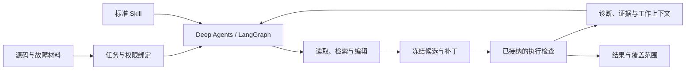

# EviMend 系统设计

状态：当前实现概览与研究设计草案。最后维护：2026-10-26。

## 1. 产品与研究对象

EviMend 接收一个有源码的故障任务，结合允许使用的日志、触发输入和检查环境调查问题、生成补丁，并以实际执行反馈修订。研究对象既可以是独立的修复任务，也可以是前序缺陷发现工作交付的局部问题。

当前实现处理审核过的源码/日志快照；新网络服务、多请求状态、原工程容器环境及上游发现结果还需分别接纳。现有对象与代码为研究提供基础，但不自动构成新方法的效果证据。

## 2. 架构与实现边界

| 部分 | 主要实现 | 作用 |
|---|---|---|
| 用户入口 | product_cli.py、cli.py | 配置、启动、状态、停止、恢复和导出 |
| Agent 与工具 | agent.py、actions.py、task_strategy.py | SDK 循环、工具授权及任务提示 |
| 模型通信 | models.py、model_provider.py、cloud_retries.py | 官方 SDK、工具消息、usage、重试和调用边界 |
| 诊断与记忆 | contracts.py、conditions.py、decisions.py、feedback.py | 假设、来源、修复义务、决策和反例关联 |
| 上下文组织 | working_context*.py、repair_context_layout.py | 按当前任务与修复状态组织工作集 |
| 修改与版本 | workspace.py、source_search.py | 原版、草稿和冻结候选的隔离与读取 |
| 执行与结果 | local_execution.py、competition.py、reporting.py | 配置检查、反馈、终态和历史兼容 |
| 过程知识 | skill_packages.py、domain_skills.py、static_skill_handoff.py | 标准 Skill、渐进读取和使用记录 |

代码中的 competition、dfx_agent 和历史报告名保留接口兼容；不改变它们的字节身份来重解释旧运行。字段、不变量与精细分支见[模块契约](../design-contracts.md)。

## 3. 从观察到可核查的解释

日志里的异常位置不直接等于根因位置。Agent 应结合源码关系提出假设，区分观察、源码事实与推断，并记录支持或反对该解释的材料。位置绑定源码版本，候选执行事实绑定真正被执行的候选。

修复义务分为需要恢复的条件和应保留的正常行为。例如容量不足可以通过扩大缓冲区或丢弃输入绕开异常，但后者可能破坏完整数据语义。义务的价值在于影响修改及检查选择，而非字段是否齐全。模型提出的语义关系不因为引用合法就成为因果真值。

有限条件检查只覆盖接纳的数值域、算子和前提，不模拟整个目标语言或运行平台。缺少观察保持未知。当前动态诊断探针未形成完整执行策略。

## 4. 候选与验证

编辑首先作用于独立草稿；登记时保存 diff、源码身份、诊断关联和候选顺序。原版输入、冻结候选和运行输出分别保存。失败编辑不污染原版；恢复不能将旧候选的检查当成新候选事实。

| 层级 | 能说明什么 |
|---|---|
| analysis | 给出分析或候选补丁，尚未执行验证 |
| synthetic | 固定响应与合成判据的软件流程检查 |
| source_execution | 实际相关源码在声明输入、转译和 mock 范围内通过检查 |
| application | 完整应用在接纳的工程、环境和动作协议下通过检查 |

配置的检查包括装载/构建、故障回放、正常与边界行为、回归。最终结果由最新候选及其实际检查派生，不选择历史上最好的候选来掩盖当前失败。模型生成的自测可以支持调查，但不得独自决定最终修复正确性。

## 5. 决策驱动调查与修订

现有决策记录能关联待证问题、修复方向、义务和反馈；相关提示与工作上下文可交给模型消费。当前真实动态调查的动作空间仍有限，不能把保存了决策等同于主动实验规划已经完成。

拟研究的最小闭环为：

1. 为相互竞争的解释列出能够区分它们的预期观察。
2. 在实际可执行且有权限的检查中，选择对修复方向有价值的一项。
3. 将结果更新为支持、反证或仍未知，保留原输入和执行版本。
4. 生成或修订补丁；失败时区分根因错误、实现错误、行为破坏与证据不足。
5. 证据指向错误诊断时重新调查，而非不断重复同一修法。

这个选择策略尚需 R1/R2 的失败分析确定，不能在迁移时视为已实现算法。没有歧义且证据足够时应允许直接修复，不强制额外工具链长度。

## 6. 模型与执行环境

主链使用 Deep Agents / LangGraph，状态和原件使用 SQLite 与文件。云端 Chat Completions 通信复用官方 SDK；目前仅对接同类协议，其他协议或型号应按实际工具调用和 usage 单独验证。

模型私有配置在 configs/*.local.json。thinking 模式、推理历史、工具结果配对与提供方协议必须一致。连接未建立或明确 429 的有限退避复用 SDK；发送结果未知时停止，不因重试而产生重复工具动作或漏算费用。

宿主执行通过已接纳的独立运行器。新研究任务优先复用项目原测试和成熟容器环境；接入 Linux、网络服务或多进程目标前，验证资源、故障复现、正常行为和停止边界。当前 Windows 支持不能外推为跨平台已验收。

## 7. Skills 的具体位置

skill/ 是唯一作者入口，每包采用 SKILL.md 和包内配套资料。已有 bounds、lifecycle、recursion、dynamic-pattern 四类过程，分别指导范围/单位、生命周期、递归、动态查询与模式问题。

默认先加载名称与 description，按需读取正文和引用资料；少量必要过程可使用宿主 metadata 扩展 dfx-load: always，计入相同上下文与调用预算。阅读不自动授权脚本执行。

经验检索、三态适用性交接、候选提炼、版本验证与演进代码保留各自契约。自动学习不是本阶段前置，未闭合的部署或真实效果不由静态 Skill 的可用性补足。

### 7.1 以当前修复决定组织工作上下文

完整原件与模型发送视图分离。代码可以从实际记录组织当前诊断、候选、义务、检查与失败，把不同版本事实区分开，并为移出的可回读证据保留导航。

已有 legacy_refill、repair_relevance、repair_frontier 选择策略，以及 record_panel、decision_layers、decision_frontier 布局；它们按冻结配置消费。需要保留探索、反证、最近有效反馈和必要工具组，不能只保留支持当前解释的片段。

工作上下文重排或压缩必须满足提供方完整消息协议。需要完整推理历史的模式不能静默裁剪；原有主机压缩模块与 SDK 默认摘要也不能未经接线便计为当前启用能力。机制实验要检查实际发送内容及后续动作，而不只核磁盘记录。

## 8. 贡献与比较

拟议贡献是用可执行证据组织修复决策，在相同模型、工具、知识和费用条件下减少无效调查与错误方向的修订，并提高独立检查通过的修复数。

验证应包含强基础 Agent、普通历史/摘要策略、最接近的已有方法与必要单因素消融。比较既包括被机制救回的任务，也包括新增失败、执行成本和缓存变化。旧样本的补丁成功不直接证明新机制有效。指标与隔离见[评测规则](../preparation/metrics-and-gates.md)。

## 9. 本机环境、资源限制与集中清理

运行边界继续由 configs/local-runtime.json 的实际值管理，不在文档复制限额。Python 原生管理器建立项目 owner、Windows Job、活动任务和停止/清理记录；生产操作不依赖 PowerShell 或 Codex。

| 路径/对象 | 归属 |
|---|---|
| .dfx-local/env、python、tools | 项目环境与已接纳工具 |
| .dfx-local/cache、tmp、work | 缓存、临时输入及运行原件 |
| .dfx-local/state、artifacts | 受管状态与检查记录 |
| runs/exports | 需保留的本机结果 |
| configs/*.local.json | 私有模型与实验配置 |
| archive、data_B、answer_B | 不由普通环境清理器自动接管的本机内容 |

安装、测试与任务通过受管入口；同时受进程、内存、CPU、时间和磁盘政策约束。失败停止，不能悄悄降低保护。已存在的平台目录管理能力不意味着有新下载或设备操作授权。

清理默认预览，核对路径、链接、归属、活动任务和证据保留。停止不删除结果；env/all 清理由 Agent 退出后的独立解释器执行。完整应用、容器或设备若有独立后台进程，需先验证停止能力，再接纳该后端。

## 10. 维护与研究接手

[模块契约](../design-contracts.md)保存精细对象及兼容规则，[研究计划](../project-work-plan.md)定义后续阶段，[STATUS](../STATUS.md)唯一记录实际完成和验证。原开发快照中的详细历史设计可由固定标签检索，不作为 main 的新实验授权或第二套当前计划。
