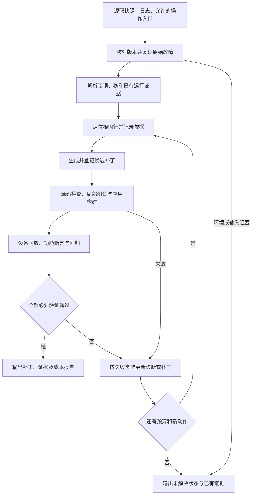

# 应用软件代码故障精准定位与自修复：完整实施计划

> 2026-09-16 执行顺序更新：用户安排先完善分析设计，远程 HarmonyOS 环境后续提供。当前优先完成 [技术设计](development/system-design-draft.md) 及离线模块规格；M0 的设备验收延后到运行阶段，不再作为继续设计的前置条件。最新进展见 [STATUS](STATUS.md)。

版本：v0.1，2026-09-15。性质：待实施方案。当前已完成数据核查与前期研究，尚未实现完整修复系统，未取得模型修复、构建或设备验证成绩。

## 1. 目标与执行顺序

交付一个面向当前 HarmonyOS/ArkTS 数据的自动化系统：输入源码与故障数据，输出原始源码上的根因位置、补丁、功能及回归验证证据、完整尝试记录和资源统计。验证失败时，系统在固定预算内继续诊断和修复；无法完成时返回明确的未解决状态及原因。

实施顺序为：**数据与验证条件 → 完整基础修复闭环 → 有针对性的诊断与验证增强 → 稳定评测与交付**。

研究主线保留为“运行时约束引导的根因诊断与修复，结合验证反馈控制下一步动作”。在成熟 Agent 和诊断方法上改进，以新增成功、减少回归、提高首次通过和控制开销来证明贡献。Skills 是机制的复用载体；微调在实际失败证据支持时才进入计划。

本批数据包含 28 个候选案例变体，26 个带崩溃文件，独立性和运行条件尚未全部确认。事实与问题记录见 [数据核查报告](preparation/data-b-assessment-2026-09-15.md)。早期 24/60 案例、84 次预算的公开数据设想不作为当前默认安排。

## 2. 从输入到结果的完整链路

离线分析可以在设备尚未就绪时开展，但不能据此进入“运行验证成功”状态。后续若提供其他日志/Trace，通过输入适配器进入同一证据结构；当前优先支持包内实际存在的 jscrash，不先建设没有数据支撑的完整 Trace 平台。

| 模块 | 核心工作 | 必须输出 | 进入下一步的条件 |
|---|---|---|---|
| 任务与环境适配 | 固定源码/日志/用例版本，准备隔离目录，选择设备和测试 | 任务清单、快照哈希、环境指纹、原始失败记录 | 输入对应，目标场景可达，故障能复现 |
| 日志分析 | 解码、字段提取、栈去噪、重复帧压缩、业务路径映射 | 带原始来源的结构化错误与候选调用链 | 缺失字段明确标记，映射有依据 |
| 根因定位 | 从报错操作追踪数据来源、初始化、边界条件或递归关系 | 有序 Top-1/Top-3 位置、根因解释、证据与未知前提 | 在任何补丁编辑前登记原源码坐标 |
| 补丁生成 | 选择满足业务要求的修改，产出实际 diff | 候选编号、父快照、补丁、修复意图与影响范围 | 补丁可应用，未破坏任务及评测配置 |
| 分层验证 | 运行局部检查、ArkTS 构建、目标回放、业务和回归测试 | 每层 PASS/FAIL/UNKNOWN、失败摘要、新日志 | 全部必要层通过才接受补丁 |
| 反馈与预算控制 | 根据失败类型选择重定位、改补丁、换检查或结束 | 尝试树、动作原因、剩余预算和终止原因 | 失败不被静默吞掉，重复无效尝试被终止 |
| 评测与报告 | 聚合位置、补丁、验证和资源记录 | 每例结果、全量汇总、可核对的轨迹 | 所有结果对应实际源码与补丁版本 |

## 3. 如何逐项覆盖竞赛指标

正式口径最终以组委会规则为准。内部始终保留逐例原始记录，以便更换汇总口径。

| 题目指标 | 实现重点 | 内部观测与验收依据 |
|---|---|---|
| 根因行定位准确率 | 区分崩溃点、根因点、可接受修复点；追踪上游约束 | 与经核验的根因行标签比较 Hit@1/Hit@3；首次定位在编辑前冻结；重定位结果另列 |
| 代码修复成功率 | 可构建的补丁及同场景设备回放 | 目标操作实际到达，目标故障消除，必要运行检查通过；编译通过单独记录 |
| 功能正确性 | 正常业务输出、状态变化和边界行为断言 | 不只看进程存活；确认排序结果、书目内容、校验一致性等与案例相关的行为 |
| 修复后稳定性 | 受影响模块回归、必要相邻流程、重复回放 | 原本通过的行为无新增失败，重复目标操作通过；报告验证覆盖及未知项 |
| 一次性方案通过率 | 在生成前收集有效上下文与约束，减少试错 | 首个完整候选补丁在任何候选专属验证前登记；所有必要验证一次通过，才记首次成功 |
| Token 消耗 | 精简相关源码与反馈，避免重复读取和空转 | 累计全部模型调用的实际 usage，包括失败调用、验证调用和回退；缓存字段防重复计数 |
| Agent 链路长度 | 明确动作选择与终止条件 | 分别统计模型调用数、工具调用数、修复轮数、关键路径深度 |
| 平均定位耗时 | 日志预处理、路径映射和有界检索 | 从任务启动到首次有效根因输出，计入任务相关预处理；失败/超时仍记录已耗时 |
| 平均修复耗时 | 减少错误候选和不必要的昂贵回放 | 从启动到最终验证或终止的总耗时，并分解定位、生成、构建、回放、回归与等待 |

内部结果以冻结任务集合为分母；没有补丁、超时、生成失败均保留。数据完整率、可复现覆盖率和正式运行结果分别披露，不能按模型成败事后删样本。时间既报全任务到终止的耗时，也可另报成功任务耗时，两者明确区分。

功能正确性与稳定性仅在已验证行为范围内成立。未经验证的项目记 UNKNOWN；补丁行重叠不能冒充根因准确率。完整定义沿用 [指标文档](preparation/metrics-and-gates.md)，其中历史样本规模已由本计划取代。

## 4. 验证器是第一阶段的核心资产

当前故障注入契约测试不能直接用作修复判据，部分断言要求错误代码继续存在。模板单元测试也未提供充分业务覆盖。需要重新建立针对修复的验证层。

### 4.1 每个接入案例先准备什么

- 原始故障版本、对应日志及正常操作序列；复现时记录新日志与失败签名。
- 目标行为的独立判据：来自产品行为、接口约束、已有可信测试或经核验的正常参考版本。
- 目标测试与回归集合，明确哪些可供 Agent 使用、哪些仅用于最终评测。
- 构建、安装、设备初始状态、缓存/用户数据准备方式和必要配置。
- 对有争议的根因行保留多种可接受解释或 UNKNOWN，不直接照抄过期注入报告。

本包缺少完整干净基线时，可在开发阶段建立经人工核验的参考修复，帮助验收测试；它留在 evaluator 中，并明确是自建参考而非官方正确补丁。仅让候选补丁与该参考补丁文本一致，不足以证明功能正确。

### 4.2 验证层及检查顺序

1. **补丁与局部逻辑检查**：识别不合法修改，并对可抽离逻辑验证关键约束。无法抽离的检查记录跳过原因，不伪造通过。
2. **ArkTS 静态检查与应用构建**：必须使用适配后的实际项目工具链；Node 片段通过不能替代这一层。
3. **目标操作回放**：安装当前补丁对应产物，确认页面到达和目标动作执行，检查进程状态与本轮新故障记录。
4. **业务结果与回归**：验证目标输出、受影响行为及必要相邻流程。候选不能通过取消功能、吞掉异常或跳过操作获得成功。
5. **接受前复跑**：开发初版暂定目标场景连续 3 次通过，并通过预先定义的回归集合；用例隔离与状态恢复一致。该次数是工程门槛，不构成长期稳定性保证。

局部检查用于筛掉不合格候选，最终报告应用运行成功仍必须经过设备或适配的 HarmonyOS 模拟器验证。验证层级优化的主要空间是减少进入设备验证的错误候选和冗余运行，不能直接省掉最终验收。

## 5. 系统如何“反复调优与自修复”

### 5.1 单个任务内的自动修复循环

第一版用一个主控制器组织工具与强模型调用，暂不依赖多 Agent 协作。首次最多生成一个完整候选；失败后才根据反馈生成下一候选。暂定每任务最多 3 个完整候选、额外诊断探针最多 1 次，另设 Token、费用和墙钟时间上限；上限在环境与模型开销测量后锁定，三组比较时保持一致。

| 反馈类型 | 控制器采取的动作 | 需要保留的证据 |
|---|---|---|
| 类型检查/编译失败 | 若属于补丁引入的问题，在当前诊断下修正；若是原始环境问题，转环境处理 | 编译器信息、对应 diff、原始构建状态 |
| 目标故障仍在 | 检查原假设和补丁是否触达原因，必要时追踪上游并重新定位 | 本轮日志、原假设被支持或反驳的部分 |
| 出现新异常或功能回归 | 撤销该候选到记录的父快照，根据被破坏的约束重生成 | 新旧测试差异、失败行为与补丁范围 |
| UI 导航/设备通信失败 | 有界重试环境或导航；不因这类失败随意修改业务源码 | 前置失败类别、环境重试次数 |
| 证据不足 | 执行最有区分力且成本可控的检查；无剩余能力时结束为未解决 | 缺失证据、选择动作的理由 |
| 重复补丁或同状态空转 | 用补丁哈希与失败签名识别，换策略或提前停止 | 尝试父子关系、重复检测与终止原因 |
| 必要验证全部通过 | 固定最终补丁及产物哈希，输出结果 | 构建、回放、功能、回归与复跑记录 |

同任务回退消耗此前实际用掉的预算，不能填入另一条满预算基线的成功结果。每个新候选从明确的源码状态开始，验证记录与候选哈希绑定，历史崩溃日志和缓存结果不能作为本轮证据。

### 5.2 开发阶段跨任务的持续改进

对开发运行归纳失败类别，改进提示、检索范围、动作规则或 Skills，重新做对照验证后发布新版本。可积累经验证的“错误特征—适用约束—操作—验证方法”，保留失败反例与适用边界。

此过程不要求训练模型参数。最终评测前冻结配置和 Skills；不得把评测答案或隐藏测试结果回写进后续任务的知识库。是否允许跨案例在线记忆由比赛规则决定，默认正式评测任务彼此隔离。

## 6. 我们拟突出的贡献

### 核心改进：约束引导的诊断与修复决策

从错误操作提取必须成立的条件，例如对象已初始化、索引有效、字节容量足够或遍历能够终止。结合栈和相关源码，追踪哪个输入、赋值或控制条件破坏了约束；用结果约束候选补丁及下一项检查。

新增设计优先体现为两个可测方面：

- **更可靠的定位与补丁选择**：相同强模型下，能否减少只修报错表象、破坏正常功能的补丁，提高根因命中及首次通过。
- **根据反馈使用验证预算**：能否在同样最终验收要求下，减少无效重试、Token 和设备执行次数，同时保留或增加最终成功。

两方面形成一条共同方法主线。成熟 harness、标准化 Skills、日志格式处理分别承担工程基础与复用职责；不需要为每个组件都声称独立创新。

### 怎样判断自己的贡献成立

采用已规划的 B0（强模型完整修复）、B1（增加结构化诊断）、P（增加约束与分层检查策略）对照。B0/B1 同样获得可用工具和执行机会，额外诊断不是免费资源。

先报告逐例新增加的成功、原成功被破坏的数量、净收益和完整成本。若只能胜过弱提示基线，或收益只来自额外预算，不能归因于新方法。模块无收益时可以从比赛配置中关闭，保留表现更好的完整系统。

首轮 6 例 × 3 组 = 18 次完整求解仅用于工程与失败机制诊断，不作为显著性证明。已阅读构造答案的当前对话不充当盲测求解器。正式划分按应用/模板谱系分组，并在看到确认成绩前冻结；论文扩展再由实验设计阶段补充独立样本、近邻方法和第二模型。

## 7. 实施阶段、产物和验收

| 阶段 | 必须完成的工作 | 可检查产物 | 阶段完成标准 | 若进展不顺 |
|---|---|---|---|---|
| M0 数据与设备验收 | 固定案例身份，隔离答案材料，适配工具链和 Hypium，先接入两个应用 | 案例清单、干净求解输入、环境说明、原始失败记录、评判规则 | 两个应用能构建安装、到达场景并稳定触发对应原始故障；测试能区分故障与有效行为 | 优先解决配置或换预先记录的候选，披露阻塞；可继续离线模块工作 |
| M1 完整基础系统 | 接通日志、定位、补丁、构建、回放、回归、重试与计费 | 基础求解器、单案例报告、尝试记录、自动汇总 | 小批任务可无人接续地跑到成功或明确失败；至少一个案例取得有功能/回归证据的完整修复 | 暂不增加研究模块，先处理闭环缺口 |
| M2 小规模机制改进 | 六个候选扩展到多类故障，加入约束型 Skills 与反馈策略，执行 18 次诊断运行 | B0/B1/P 逐例结果、失败归因、初版消融 | 能说明新增模块在哪些真实失败中起作用、损害和开销有多少 | 只做由失败证据支持的有限调整，无信号则关闭增强 |
| M3 覆盖与鲁棒性 | 扩展到所有预先接纳案例，处理变体，完善正常行为与回归测试 | 冻结划分、全量运行报告、重复运行与成本统计 | 所有接入任务均可自动处理并输出状态；最终配置在保留组上获得可报告的效果与开销 | 缩小复杂策略，保住完整流程与覆盖；未解决案例如实记录 |
| M4 比赛冻结交付 | 锁定模型/配置/Skills，复核独立运行，整理设计、代码、测试和 sessions | 可安装/可运行包、使用说明、标准化 Skill/Spec、最终报告 | 在说明的环境中从输入到结果可重复执行，所有指标可追溯 | 冻结期只修影响正确性、运行和交付的缺陷 |
| M5 论文扩展 | 根据比赛实证收敛问题，补公开或获授权的独立数据及近邻对照 | 机制证据、泛化分析、复现材料与论文 | 结论与实际证据范围一致，新增贡献可归因 | 缩小主张或追加证据，不将比赛名次等同论文质量 |

阶段之间的门槛是工程验收条件，不是每一步都向用户请求批准。M1 应覆盖完整链路，M2 才决定额外方法是否值得保留；不能把“18 次小试”当成完整项目的终点。

截止日期和人手尚未提供，暂不承诺日历完成时间。建议可用工时大致分为：20% 数据与验证条件、35% 完整闭环、20% 增强与比较、25% 覆盖/冻结/交付。环境耗时超过预期时压缩新增机制，最后四分之一时间停止增加方法模块。

## 8. 接下来第一批开发任务

1. **任务标准化**：从只读清单建立固定源码哈希、应用/版本/用例组合标识、日志选择依据与接入状态；013/018 等缺失项单独记录，不自动猜补。
2. **验证条件落地**：确认现有 DevEco/SDK、签名和设备位置，在隔离副本适配两个候选应用的构建、安装与 Hypium 入口；先复现原故障并定义业务判据。
3. **最小完整求解器**：接入一个强模型，提供源码读取、检索、补丁与运行工具，打通一次自动修复和完整结果记录。
4. **失败驱动的再修复**：接入明确的失败类型、父快照恢复、候选计数、成本限制和结束状态，验证失败后能自动继续。
5. **小规模对照与增强**：在完整基础系统上加入结构化诊断和约束型 Skills，检验首次通过、净收益和成本。

第一批开发的优先顺序由任务依赖决定。数据核验和离线适配可先推进，设备与 API 条件影响实际运行；不需要等所有不确定性消失才编写可独立验证的部分。

## 9. 拟落到现有模板的实现与交付位置

以下是开发任务的拟定位置，当前尚未创建这些实现目录或声称已有功能。

| 位置 | 开发职责 |
|---|---|
| `src/dfx_agent/task/` | 任务清单、输入适配、版本及工作目录管理 |
| `src/dfx_agent/diagnosis/` | 日志、栈、根因位置与约束证据 |
| `src/dfx_agent/repair/` | 补丁生成、候选与状态恢复 |
| `src/dfx_agent/runtime/` | HarmonyOS 构建、设备及 Hypium 适配 |
| `src/dfx_agent/controller/` | 状态机、反馈策略、预算和终止 |
| `src/dfx_agent/reporting/` | 轨迹、指标、逐例与汇总报告 |
| `skill/` | 初始化、边界/字节、递归、正则等标准化 Skills 与验证动作 |
| `tests/` | 系统测试、修复验证器和隔离的评测支持 |
| `resources/` | 任务配置、允许的知识资料、评测清单；求解器只读取明确允许部分 |
| `docs/technical-design.md` | 随实现更新的最终设计说明 |
| `docs/test-report.md` | 实测指标、运行条件、失败与限制 |
| `sessions/` | AI 辅助开发过程摘要与产物关联 |

单次运行至少导出任务/源码/配置/补丁标识、定位候选、尝试序号、验证分层结果、错误类型、终止原因、模型 usage、调用数与分段耗时。字段从 M1 起记录，避免最后补报无法核对的资源消耗。

## 10. 当前状态与阶段交接

已完成：数据结构与风险核查、只读清单、来源及技术路线、指标草案和本实施计划。待完成：运行验收及完整系统实现。当前 `src/` 已有离线证据处理原型；模型根因诊断、补丁生成和执行控制器尚未完成，不能视为已有完整求解器。

当前没有 `ccfa.yaml`，未建立该格式的项目状态跟踪；本文件作为阶段记录入口。若以后采用该文件，可将阶段设置为数据/环境验收中，把 M0 输入、产物、运行证据和未决条件纳入记录，不需要现在为规划另建论文目录。

下一阶段的工程工作按第 8 节推进；根因标注、测试判据和正式对照口径由 `ccf-experiment-designer` 负责细化，实际 Skill 编写按技能创建流程进行。本轮仅完成实施规划，没有启动安装、设备操作、模型运行或模型训练。
